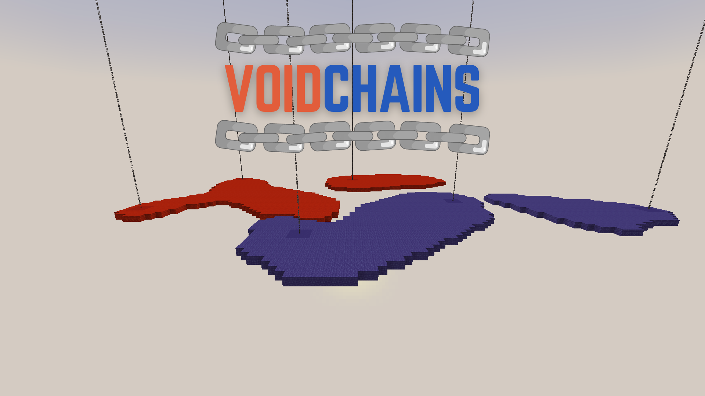

# Void Chains

> **AVAILABLE ON 26.3**
>
> **Click [here](https://github.com/AjjMC/Void-Chains/archive/refs/heads/main.zip) to download.**
>
> **For any queries, please use the issues section.**

> **FEATURED BY MOJANG**
>
> **[Java Realms Release](https://www.minecraft.net/en-us/article/new-on-java-realms-survival-the-remix)**
>
> **Published on Java Realms in April, 2025.**

  

## Overview

Void Chains is a PvP minigame that brings together aspects from several game modes, including KOTH and Spleef. The two competing teams battle in an arena consisting of Anchors and Bridges, suspended over the void.

**A TEAM'S ANCHORS...**

* Act as respawn points for the team.
* Can be generated by the team on its Bridges.
* Can be claimed by the other team.

**A TEAM'S BRIDGES...**

* Can be formed from within the team's territory.
* Collapse if they are not connected to any of the team's Anchors.
* Override the other team's Bridges.

**A TEAM WITHOUT ANCHORS...**

* Cannot respawn until an Anchor becomes available.
* Loses if none of its players are able to play.

## Getting Started

In the hotbar:
* Read the game info.
* Select a team.
* Select a kit.

In the play barrel:
* Adjust the game settings.
* Start the game.
